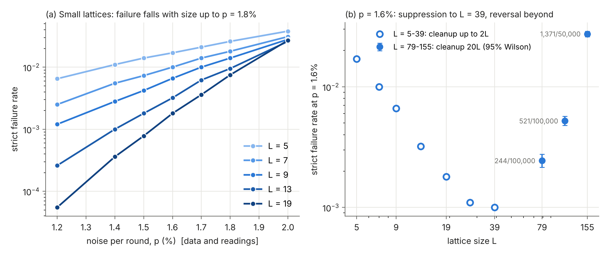

# Learning Local Rules for Quantum Error Correction at Scale

**Pilot results.** Rathindra Nath Das, MIT Center for Theoretical Physics. All numbers here are **simulated**.

A decoder for the toric code that is **learned** and **strictly local**. The same small neural network runs at every check
site. Each site keeps 16 memory values, and at each of six updates per measurement round it sends eight values to each of
its four nearest neighbours. There is no global processing step: the corrections come from the local rule alone. The
network has under 9,000 parameters and was trained by imitating a matching decoder.



## Results

**1. Small lattices: errors are suppressed.** With bit flips of probability p on the data qubits and on the check
readings in every round, the failure rate falls with lattice size at every p up to 1.8% for L = 5 to 19 (panel a).
This uses the measurement protocol of [Lake, arXiv:2510.08056](https://arxiv.org/abs/2510.08056): L noisy rounds, then up to
2L noiseless rounds of the rule. For comparison, Lake reports a threshold of about 1.5% for his hand-designed local
decoder under depolarizing noise with measurement errors of equal strength, a related but not identical noise model.
Ours is a finite-size crossing, not a threshold: including L = 27 and 39 it drifts down to about 1.7-1.8%.
Full table: [results/small-lattices-lake-protocol.md](results/small-lattices-lake-protocol.md).

**2. Large lattices: the trend reverses.** At p = 1.6%, after L noisy rounds and 20L noiseless cleanup rounds:

| Lattice size | Simulated trials | Strict failures | Failure rate | Of which unresolved at the deadline |
|---|---|---|---|---|
| 79 x 79 | 100,000 | 244 | 0.244% | 211 |
| 111 x 111 | 100,000 | 521 | 0.521% | 451 |
| 155 x 155 | 50,000 | 1,371 | 2.742% | 1,354 |

A strict failure means the stored information was corrupted or error signals remained at the deadline. Other noise rates
and cleanup times: [results/large-lattices-merged-output.md](results/large-lattices-merged-output.md) (verbatim output of the
merge step; 313 of 378 shards, all shards of the p = 1.6% points complete).

**3. What is left unresolved.** In 154 unfinished states saved after 6L cleanup rounds (L = 111 at p = 1.6% and 1.7%,
L = 155 at p = 1.6%), 136 contain exactly two error signals, typically about 0.4 L apart:
[results/unfinished-states.md](results/unfinished-states.md).

**4. Compute.** The large-lattice array used about 94 GPU-hours (A30 / RTX 6000) for one checkpoint:
[results/compute-usage.md](results/compute-usage.md).

## Files

| Path | What |
|---|---|
| `decoder_v41.py`, `decoder_v7.py`, `decoder_tests.py` | The local rule, its training and basic evaluation (unmodified; the result files quote their hashes) |
| `diag_largeL2.py` + `submit/lake1_cpu.sbatch`, `submit/tasks-lake1.txt` | Result 1 (small lattices) |
| `submit/submit_eval.py` + `submit/eval_gpu.sbatch`, `submit/tasks-w1b.txt` | Result 2 (large lattices) |
| `diag_largeL.py` + `submit/diag1_score.sbatch`, `submit/tasks-diag1.txt`; `p3_axis.py` | Result 3 (saved unfinished states and their analysis) |
| `data/` | The numbers behind the figure |
| `figures/make_figures.py` | Draws `figures/pilot_results.png` from `data/` |
| `runs/nca-v10-big/` | The trained rule (`config.json`, `model_last.pt`) |

## Reproducing

```
pip install -r requirements.txt
python decoder_v7.py check                                      # self-tests of the rule and the simulator
python figures/make_figures.py                                  # the figure, from data/
python diag_largeL2.py score --L 19 --p 0.016 --shots 20000 --batch 500 --seed 1 \
       --models model_last.pt --cks 0,2 --sub lake1 --out results-local --device cpu    # one small-lattice point
```
The job files (`submit/*.sbatch`) are the exact Slurm scripts used; they contain the cluster's paths and environment and
need those adapted. Each task line holds its own seed, so every reported shard can be rerun individually.

**Training record.** The rule (`v10-big`) was trained on a laptop GPU by fine-tuning an earlier checkpoint of the same
architecture, with extra cleanup drills on larger lattices:
```
python decoder_v7.py train --init v8-ctrl --K 6 --max-iters 12000 --minutes 240 --snap-at 6000 --seed 11 \
       --drill-Ls 39,55 --drill-big-frac 0.15 --batch-drill 8 --label v10-big
```
The released checkpoint `model_last.pt` is the reference for all results above.

## Notes

- The small-lattice rates are recorded to two significant figures; with 100,000-300,000 trials per point their
  statistical uncertainty is small except at the lowest rates.
- Panel (b) combines two cleanup deadlines (2L for L <= 39, 20L for L >= 79). Up to L = 39 almost no trial is left
  unfinished (at most 49 of 300,000), so the shorter deadline makes no material difference there.
